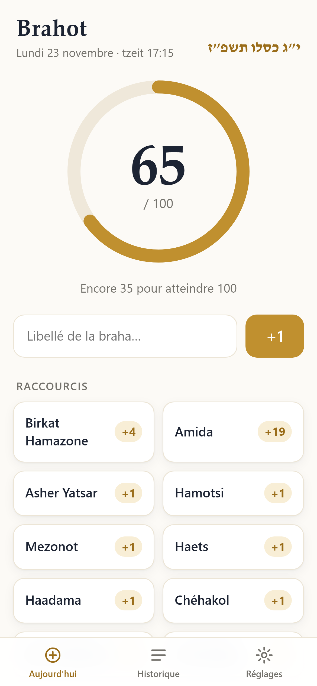
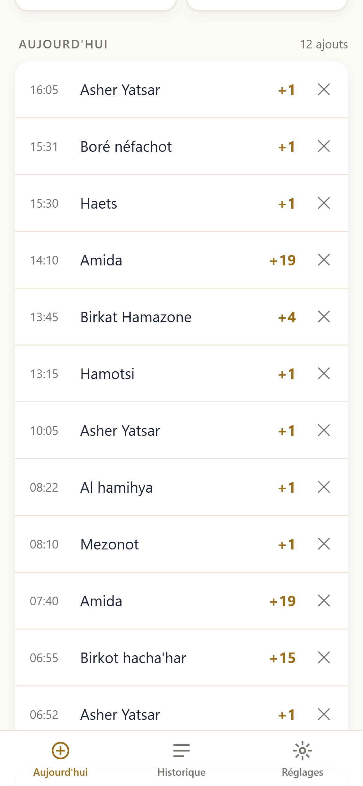
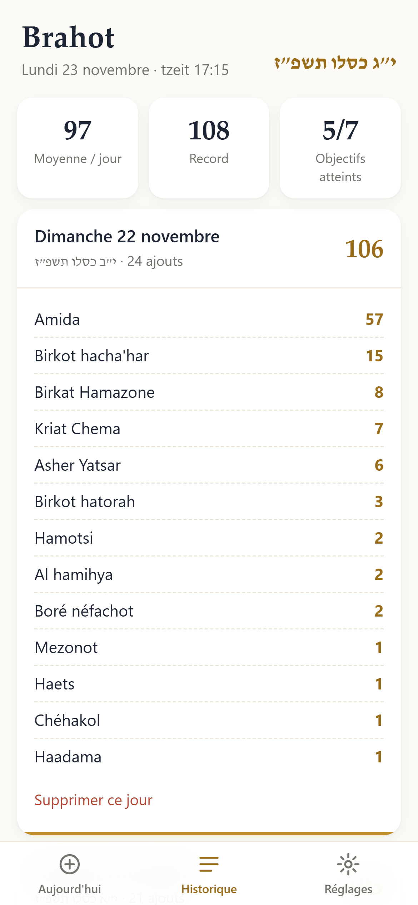
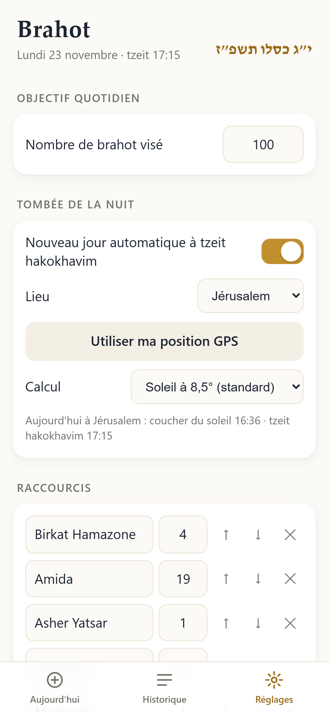

<div align="center">


# Brahot

**A daily blessing counter for your phone, aiming for 100 brahot a day.**

Count each braha in one tap, see your progress towards the daily goal, and let the day roll over automatically at nightfall (tzeit hakokhavim). Everything is stored on your device, with no account and no server.

[**Live demo**](https://nathan-part.github.io/brahot/) · [Features](#features) · [Tech stack](#tech-stack) · [Getting started](#getting-started)


[](LICENSE)

</div>

<p align="center">
  
  
  
  
</p>

## Features

- **One-tap counting**: type a label and press **+1**. Labels you have already used are suggested as you type.
- **Shortcuts** for common blessings, such as Birkat Hamazone (+4) or Amida (+19). You can add, rename, reorder or delete them in the settings.
- **Daily goal** (100 by default) with a progress ring and a message once it is reached.
- **Undo**: adding or removing a braha, deleting a shortcut or starting a new day shows a toast with an **Annuler** button.
- **Automatic new day at nightfall**: at tzeit hakokhavim the current day is archived and the counter goes back to zero. You can also press **Jour suivant** to do it manually.
- **Zmanim computed offline**: sunset and nightfall are calculated on the device for 18 preset cities (Israel, France, Belgium, Switzerland, UK, Canada, USA) or for your GPS position, with a choice of 8.5° or 7.08° below the horizon.
- **Hebrew date** written in Hebrew letters (e.g. י״ג כסלו תשפ״ז). It changes at nightfall, not at midnight.
- **History** with daily average, best day, goals reached, and a breakdown by braha for each day.
- **Backup and restore** to a JSON file, so you can move to a new phone.
- **Works offline** and installs to the home screen like a native app.

> The interface is in French.

## Privacy by design

Brahot is **local-first**. All data lives in the browser's `localStorage` on your phone. The app makes no network requests at all: no server, no account, no tracking and no analytics. If you use the GPS option, the position is rounded to about 100 m and only stored on the device to compute nightfall. The app also asks the browser for persistent storage so your data is not evicted.

Because nothing is synced, export a backup from time to time (**Réglages → Sauvegarde → Exporter**).

## Tech stack

| Area | Choice |
| --- | --- |
| UI | Plain HTML, CSS and JavaScript, no framework |
| Build | None: the files in the repository are the app |
| Storage | `localStorage`, one JSON document validated on every load and import |
| PWA | Hand-written service worker (stale-while-revalidate) and web manifest |
| Zmanim | "Almanac for Computers" solar algorithm, computed offline |
| Hebrew date | `Intl.DateTimeFormat` with the Hebrew calendar, plus custom gematria formatting |
| Hosting | GitHub Pages |

### Implementation notes

- **Halachic day**: a day is identified by its civil date, plus one if the time is after tzeit hakokhavim. The rollover check runs every 30 seconds and whenever the app comes back to the foreground, so it also works after the phone has been asleep.
- **Timezone-safe sunset**: the solar algorithm gives a time modulo 24 h. The app picks the occurrence closest to local solar noon plus the hour angle, so the right evening is used wherever you are. At extreme latitudes with no night, the day simply changes at midnight.
- **Gematria**: numbers are written in Hebrew letters with geresh and gershayim, including the special forms ט״ו and ט״ז for 15 and 16.
- **Safe imports**: backup files are sanitized field by field (types, ranges, string lengths) before they replace the current data.
- **Multi-tab sync**: if the app is open in several tabs, they stay in sync through the `storage` event.
- **Tiny footprint**: about 47 kB of source in total, with zero dependencies.

## Getting started

There is nothing to install or build. You only need a local web server, because service workers do not run from `file://`. For example, with Python 3:

```bash
git clone https://github.com/Nathan-Part/brahot.git
cd brahot
python -m http.server 8000
```

Then open http://localhost:8000. Any other static server works too, for example `npx serve`.

> **Tip:** the service worker serves files from its cache first, so after editing a file you may still see the old version. In Chrome DevTools, go to **Application → Service Workers** and tick **Update on reload**, or do a hard refresh (Ctrl+Shift+R).

## Deployment

The app is a fully static site, so it can be hosted for free anywhere.

**GitHub Pages**: in the repository settings, go to **Pages → Build and deployment**, set **Source** to **Deploy from a branch**, pick `main` and `/ (root)`, then save. The site is online after about a minute.

**Updates**: installed apps update themselves. The new version is downloaded in the background and shown on the next launch. To force every file to be downloaded again, bump `CACHE` in `sw.js` (for example `brahot-v2`).

## Install on your phone

Open the [live site](https://nathan-part.github.io/brahot/), then:

- **iPhone (Safari)**: Share → **Add to Home Screen**
- **Android (Chrome)**: menu ⋮ → **Install app**

## Project structure

```
├── index.html             # App shell: Today, History and Settings views
├── app.js                 # State, rendering, zmanim, Hebrew date, backup
├── styles.css             # Design tokens and components
├── sw.js                  # Service worker (offline cache, auto-update)
├── manifest.webmanifest   # PWA manifest
├── icons/                 # App and home-screen icons
└── docs/screenshots/      # Screenshots used in this README
```

## License

[MIT](LICENSE) © Nathan-Part
